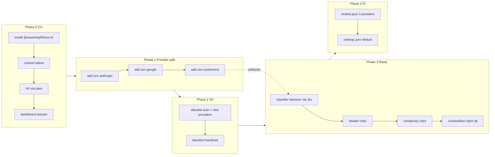

# Bifrost CLI + UI + Pi: route all model selection to the gateway

## Context

Pi currently picks a physical model and sends it to the Bifrost gateway. We want
the opposite split: **Pi sends one logical model ID (`auto`) and Bifrost decides
everything** — complexity tier, provider, physical model, fallback chain,
weights.

Two reasons this is the right seam:

1. Routing metadata Pi cannot see (`complexity_tier`, budget burn, upstream key
   health) lives on the gateway.
2. A router inside Pi would have to learn about Pi's model registry, and every
   model switch fragments provider prompt-cache locality.

The Bifrost CLI is the missing piece. The admin API rejects the virtual key
(`/api/routing/*`, `/api/governance/*`, `/api/adaptive-routing/*` all 401), so
without the CLI every rule change is a click-path in the dashboard. The CLI
stores an *OSS dashboard session* credential, which is exactly the gap.

Gateway: `https://bifrost.gerbil-matrix.ts.net`, `GET /api/version` = `"v2.3.0"`.
CLI: `@maximhq/bifrost-cli` v1.0.1.

## Revision note

v2 of this plan (2026-10-25). v1 concluded that GPT, Claude, and Gemini were
unreachable and proposed blacklisting them. That was **wrong**, and the
correction reshaped Phase 1: OpenCode Zen serves those models from different base
URLs (up to four protocol families), while Bifrost holds a single base URL per
provider. It is a provider-configuration gap, not a missing entitlement. See
F15–F18.

```
Pi ──model:"auto"──▶ Bifrost /v1/chat/completions
                       ├─ Virtual Key   → provider scope, allow/denylist, weights, budgets
                       ├─ Routing Rules → CEL → weighted target + fallbacks
                       └─ Complexity Analyzer → complexity_tier ∈ SIMPLE|MEDIUM|COMPLEX
```

---

## Findings that shape the plan

All from live probes against this gateway on 2026-10-25, or from Bifrost
upstream source.

| # | Finding | Evidence | Consequence |
| --- | --- | --- | --- |
| F1 | The VK cannot see model `auto` | `{"message": "Model 'auto' is not allowed for virtual key 'Main'"}` | Must add `auto` to the VK allowlist **before** any request will route |
| F2 | 55 of 85 models reject the requests Bifrost sends them with `ModelProtocolUnsupported` | live sweep; all Claude, Gemini, Grok, muse, jev, **and GPT** | 17 models usable. Root cause is F15, not the models |
| F3 | 10 models `FreeTierError`, 3 models `410 Endpoint is unavailable` | live sweep | Must never enter a pool |
| F4 | Decision classifier **requires a decision-capable provider entry** | `unsupported_operation: decisions is not supported by opencode-zen provider`; `DefaultComplexityDecisionProvider = schemas.Typesafe` | Default classifier cannot run today — but F16 shows Jev is on the subscription via the systemone endpoint |
| F5 | Semantic classifier **requires an embedding provider** | `embedding is not supported by opencode-zen provider`; `semantic config requires an embedding_model` | Same blocker. No embedding provider on this VK |
| F6 | `classifier` omitted defaults to **semantic**, not decision | `ComplexityAnalyzerConfig.Classifier` doc comment | An unset field silently selects a classifier that cannot work here |
| F7 | Chat-completions LLM fallback classifier exists and needs only a chat model | `plugins/routing/complexity/llmclassifier.go`; `ComplexityLLMConfig{Provider, Model, Timeout, Prompt}` | **The only classifier that works on today's VK.** Anything in the 17-model usable set |
| F8 | VK is single-provider (`opencode-zen`) | `GET /v1/models` → 85 models, one provider | No cross-provider weighted LB. Provider routing is a no-op |
| F9 | 8 chat-completions-usable models support neither dev role nor reasoning | overrides probe: `thinkingLevelMap` all `null`, `supportsDeveloperRole: false` | Set `compat`/`reasoning` from the patch file, not by guessing |
| F10 | Bifrost provider aliases live on the provider **key**, not the VK | OpenAPI `Key.properties.aliases`: "maps a user-facing model name to a provider-specific identifier" | Alternative fix for F1 if VK allowlisting `auto` is not enough |
| F11 | Adaptive Routing is Enterprise-only | absent from the OSS `llms.txt` index; present under Enterprise | Use Routing Rules for balancing |
| F12 | CLI has no complexity-analyzer resource command | `bifrost resources list` core set: `providers`, `credentials`, `virtual-keys`, `teams`, `customers`, `routing-rules`, `logs` | Analyzer config via dashboard, or `bifrost api call` |
| F13 | Admin API 401 with VK; `GET /api/adaptive-routing/config` returns the HTML shell on VK auth | probe | Management commands need a dashboard session → CLI `bifrost auth login` |
| F14 | Usable chat-completions models and their metadata | live sweep + `model-overrides.json` | Tier pools below are drawn from these |
| F15 | **OpenCode Zen serves four protocols from four different base URLs, and Bifrost has it as one provider with one base URL** | Zen's own model table (`opencode.ai/v2/docs/console/models/`) pairs each model with its endpoint; see the family table below | **Root cause of F2.** Not a gateway bug, not a missing entitlement — a provider-configuration gap |
| F16 | **Jev is on the Zen subscription** (`inference/systemone/v1/systemone`, 2 models) | same table; `opencode-zen/jev-1.13` is already in `GET /v1/models` | The decision classifier becomes gateway-local — no Typesafe subscription, no API credit |
| F17 | Bifrost ships `opencode-zen` **and** `opencode-go` as built-in provider identifiers | `ModelProvider` enum in the OpenAPI spec | Combined with `network_config.base_url` + `base_provider_type`, the split is expressible without custom plumbing |
| F18 | The protocol split does **not** follow vendor | qwen3.5-plus / qwen3.6-plus / qwen3.8-flash are on the **anthropic** endpoint; deepseek-v4.1-flash is on **openai** | Tier pools must be built from the Zen endpoint table, not from vendor assumptions |

> [!IMPORTANT]
> **F15 supersedes the original framing of this plan.** I first read F2 as "GPT,
> Claude, and Gemini are not reachable." That was wrong. They are all on the
> OpenCode Zen subscription; the gateway just cannot reach them because it holds
> a single base URL per provider and Zen needs up to four. Phase 1 is therefore
> a provider-configuration fix, not a blacklist of broken models — and it is what
> makes the frontier tier real *and* fixes the classifier (F16).

### OpenCode Zen protocol families

From Zen's own model table. Every model on the subscription belongs to exactly
one family, and each family needs its own base URL in Bifrost.

| Family | Endpoint | Count | Models | Bifrost config |
| --- | --- | --- | --- | --- |
| `openai` (Responses) | `inference/openai/v1/responses` | 31 | all `gpt-*`, all `grok-*`, all `muse-*` | existing `opencode-zen` entry ✓ |
| `openai` (chat completions) | `inference/openai/v1/chat/completions` | 26 | `qwen3.8-max`, `deepseek-v4.1-flash`, `deepseek-v4-pro`, `minimax-m*`, all `glm-*`, all `kimi-*`, `mistral-large-4`, the `*-free` tail | existing `opencode-zen` entry ✓ |
| `anthropic` | `inference/anthropic/v1/messages` | 17 | all `claude-*`, **`qwen3.8-flash`, `qwen3.6-plus`, `qwen3.5-plus`** | **new provider entry** |
| `google` | `inference/google/v1beta/models/…` | 8 | all `gemini-*` | **new provider entry** |
| `systemone` | `inference/systemone/v1/systemone` | 2 | `jev-1.13`, `jev-1.13-free` | **new provider entry → unblocks the decision classifier** |

> [!WARNING]
> F18 bites here. `qwen3.8-flash` is currently in the working `MEDIUM` pool via
> the openai/chat-completions path — but Zen documents it on the **anthropic**
> endpoint. It works today through the relay, so it can stay, but do not assume
> that holds after the provider split. Re-verify every pool member (Phase 4.1)
> rather than trusting the pre-split sweep.

Usable today, single-protocol (17): `deepseek-v4-flash`, `deepseek-v4-pro`,
`deepseek-v4.1-flash`, `glm-5`, `glm-5.1`, `glm-5.2`, `glm-5.3`,
`glm-5.3-flash`, `kimi-k3`, `minimax-m2.5`, `minimax-m2.7`, `minimax-m3`,
`mistral-large-4`, `qwen3.5-plus`, `qwen3.6-plus`, `qwen3.8-flash`,
`qwen3.8-max`. This is the **fallback** pool set if the provider split cannot be
made to work.

---

## Approach

Five phases. Phases 0–2 touch no Pi config, so Pi keeps working on its current
single-model setup until Phase 4.

| Phase | What | Blocked by |
| --- | --- | --- |
| 0 | Install Bifrost CLI, wire contexts + credentials from `pass` | nothing |
| 1 | **Provider split**: add `zen-anthropic`, `zen-google`, `zen-systemone` | nothing |
| 2 | VK: admit `auto` + the new providers; blacklist dead weight | Phase 1 |
| 3 | Classifier (`decision` via Jev) + routing rules | Phases 1–2 |
| 4 | Pi: three provider entries, new default | Phase 3 |
| 5 | Verification + tier tuning loop | Phases 0–4 |

**Why the provider split comes first.** It changes what routing *can* target. If
it works, the frontier tier reaches real GPT/Claude/Gemini models and the
classifier becomes gateway-local Jev (F16). If it fails, Phases 2–4 still work
against the 17-model fallback set and only the Tier-2 pools change. Doing it
first means the tier pools in Phase 3 are written once, against the real model
list, instead of being rewritten.

### Decision: fix the split, or blacklist and move on

| | Fix the split (this plan) | Fallback: single-protocol |
| --- | --- | --- |
| New provider entries | 3 | 0 |
| Frontier tier | real GPT-6 / Claude Opus 5.5 / Gemini 4 | Qwen3.8-max, DeepSeek-v4-pro, Kimi-k3 |
| Classifier | `decision` on Zen Jev (local, no extra cost) | `llm` on `glm-5.3-flash` |
| Risk | provider config may not accept a second `opencode-zen`; needs `custom_provider_config` | none — ships today |
| Blast radius | gateway-wide; other clients on `opencode-zen` unaffected because new IDs are separate | none |

Recommended: **fix the split**, with the single-protocol path kept live as a
rollback (the `opencode-zen` entry is not modified in Phase 1, only extended
around). Both paths share Phases 0, 2, 4, 5.



---

## Phase 0 — CLI bootstrap

### Install

`@maximhq/bifrost-cli` v1.0.1 is an installer that drops a binary at
`~/.bifrost/bin/bifrost` and verifies a SHA-256 when published. Node is
`v26.12.1` locally, well past the Node 18 floor. macOS Keychain is available, so
credentials land in the keyring, not a file.

```sh
npx -y @maximhq/bifrost-cli
bifrost version
bifrost routing-rules --help      # confirm flags; unverified in docs
```

Updated later with `bifrost update` — which means **nix must not own the binary**.
Treat the CLI as a self-updating userland tool, like the existing bob-managed
Neovim. Nix owns only the PATH entry.

### New pass entries

Two secrets the CLI needs, neither currently in `pass` (only `API/BIFROST_VK`
exists):

| Entry | Contents |
| --- | --- |
| `API/BIFROST_ADMIN_PASSWORD` | dashboard admin password |
| `API/BIFROST_ADMIN_USER` | dashboard admin username (optional; default in code) |

`pass ls API` already exposes `API/TYPESAFE_API_KEY`, `API/ANTHROPIC_API_KEY`,
`API/OPENAI_API_KEY`, and `API/OLLAMA_API_BASE` — relevant to the Phase 1
provider decision below.

### Nix changes

`.config/nix/home/shell/default.nix` — add the PATH entry inside the existing
`profileExtra` PATH block, and the env vars in the **PI ENV VARIABLES** section
(which already holds gateway config at lines 88–94):

```nix
# in profileExtra, alongside the other PATH exports
export PATH="${config.home.homeDirectory}/.bifrost/bin:$PATH"

# replaces the current PI ENV VARIABLES block
export BIFROST_BASE_URL="https://bifrost.gerbil-matrix.ts.net"
export BIFROST_ADMIN_USER="admin"
export BIFROST_VK_PASS="API/BIFROST_VK"
export BIFROST_OUTPUT="json"
```

No secrets in the store — every credential resolves through `pass` at call time,
matching the pattern already used in `.pi/agent/models.json:5`.

> [!WARNING]
> `shell/default.nix` currently exports `PI_PROVIDER="bifrost"` and
> `PI_MODEL="opencode-zen/qwen3.8-flash"` with a comment claiming it "defaults a
> fresh Pi session to the Bifrost gateway." Per `docs/environment-variables.md`,
> `PI_PROVIDER`/`PI_MODEL` are things **Pi sets for its tools**, not things Pi
> reads as config. The real default lives in `.pi/agent/settings.json`
> (`defaultProvider`/`defaultModel`). Either these exports are vestigial or a
> local extension consumes them — worth confirming before editing.

### Shell functions

Add to `.config/nix/home/shell/ai.zsh`, next to `pi-commit`, which already shows
the house style for `emulate -L zsh` + `setopt localoptions pipefail`:

```zsh
# Warm the Bifrost CLI context: VK for inference, dashboard session for
# management. Both credentials resolve from pass at call time; nothing is
# persisted in the nix store or in shell startup.
bifrost-auth() {
  emulate -L zsh
  setopt localoptions pipefail
  command -v bifrost >/dev/null || { print -u2 -- 'bifrost CLI not installed'; return 1; }
  bifrost context use tailnet >/dev/null 2>&1 ||
    bifrost context add tailnet --base-url "$BIFROST_BASE_URL" --use || return 1
  pass show "$BIFROST_VK_PASS" | bifrost auth set-virtual-key --stdin || return 1
  pass show API/BIFROST_ADMIN_PASSWORD |
    bifrost auth login --username "$BIFROST_ADMIN_USER" --password-stdin || return 1
  bifrost doctor
}

# Apply every rule file to the gateway. Pass --dry-run to preview.
# Rules are the source of truth in $dir; the dashboard is read-only here.
bifrost-rules-apply() {
  emulate -L zsh
  setopt localoptions null_glob pipefail
  local dir="${BIFROST_RULES_DIR:-$HOME/.config/bifrost/routing-rules}"
  local f
  for f in "$dir"/*.json; do
    print -- "→ ${f:t}"
    bifrost routing-rules create --file "$f" "$@" || return 1
  done
}
```

`bifrost doctor` verifies health, management auth, and model discovery in one
call — that is the Phase 0 acceptance test.

### Rule files

Store the Phase 2 rule set as one JSON file per rule under
`~/.config/bifrost/routing-rules/`. Keeping them as files means `bifrost-rules-apply --dry-run`
previews the whole set, and the set is diffable.

> [!NOTE]
> `create` will hit `409 Conflict` when a rule with the same `priority` already
> exists in the scope. First provisioning is clean; subsequent edits need
> `bifrost api call updateRoutingRule --param rule_id=...` or a delete-then-create
> step. Confirm the exact shape with `bifrost routing-rules --help` after install.

---

## Phase 1 — Provider split

Three new provider entries, each pointed at one Zen protocol family. The existing
`opencode-zen` entry is **left alone** so the 17 working models stay reachable and
the whole phase is reversible by deleting the three new entries.

### Target shape

| Provider ID | Family | `base_url` | Models gained |
| --- | --- | --- | --- |
| `opencode-zen` *(unchanged)* | openai (responses + chat) | gateway default | 57 already reachable |
| `zen-anthropic` | anthropic | `https://opencode.ai/inference/anthropic/v1` | 17 (all `claude-*`, `qwen3.*-plus`, `qwen3.8-flash`) |
| `zen-google` | google | `https://opencode.ai/inference/google/v1beta` | 8 (all `gemini-*`) |
| `zen-systemone` | systemone → openai | `https://opencode.ai/inference/systemone/v1` | 2 (`jev-1.13`, `jev-1.13-free`) |

### How to express it

Two candidate mechanisms; Bifrost decides which applies. Confirm against
`bifrost providers --help` and `bifrost api describe addProvider` before running
anything.

**Mechanism A — `custom_provider_config.base_provider_type` (most likely).**
`AddProviderRequest` accepts any `provider` string plus a
`custom_provider_config` block whose `base_provider_type` is one of Bifrost's
built-in protocol implementations (`anthropic`, `gemini`, `openai`). That is
Bifrost's mechanism for "a custom endpoint that speaks protocol X." The
`allowed_requests` map then declares which operations the endpoint accepts —
relevant because Zen's Anthropic endpoint does not serve `chat_completion`, and
its systemone endpoint serves `decisions` natively:

```json
{
  "provider": "zen-anthropic",
  "network_config": { "base_url": "https://opencode.ai/inference/anthropic/v1" },
  "custom_provider_config": {
    "base_provider_type": "anthropic",
    "allowed_requests": { "list_models": true, "chat_completion": false }
  }
}
```

```json
{
  "provider": "zen-systemone",
  "network_config": { "base_url": "https://opencode.ai/inference/systemone/v1" },
  "custom_provider_config": {
    "base_provider_type": "openai",
    "allowed_requests": { "decisions": true, "list_models": true }
  }
}
```

**Mechanism B — reuse built-in IDs.** The `ModelProvider` enum already includes
`opencode-zen` and `opencode-go`. `opencode-go` points at
`opencode.ai/inference/go/openai/v1` per models.dev — a third openai-flavoured
endpoint, not the Anthropic or Google one. So this only helps if Bifrost permits
**two provider entries with the same identifier and different `base_url`s**,
which the single-keyed provider map suggests it does not.

Mechanism A is the plan. Mechanism B is the fallback if custom providers cannot
carry an API key.

### Keys

Each new provider needs its own key entry via
`/api/providers/{provider}/keys`. Use `API/BIFROST_VK` from `pass` for all three —
same Zen credential, `env.BIFROST_VK` reference so the literal never lands in the
config store or on an API response.

```sh
bifrost providers list --output json
bifrost providers add --file ~/.config/bifrost/providers/zen-anthropic.json --dry-run
bifrost credentials create zen-anthropic --file ~/.config/bifrost/providers/zen.key.json
```

> [!WARNING]
> `network_config.base_url` and `allow_private_network` require a genuinely
authenticated admin session — the spec says requests are refused with `403`
otherwise. That is why Phase 0.6 (`bifrost doctor` reporting management auth ok)
gates this phase.

> [!CAUTION]
> Two unproven assumptions here: (1) that a custom provider can carry an API key,
> and (2) that `zen-systemone` mapped to the `openai` base will actually serve
> `/v1/decisions`. Both are checkable before committing — see 1.1–1.3. If (2)
fails, the classifier falls back to F7's `llm` path and nothing else changes.

### Acceptance

Each new provider must answer a real request before Phase 2:

```sh
for p in zen-anthropic zen-google zen-systemone; do bifrost models list --provider $p; done
```

---

## Phase 2 — Gateway: unlock what routing needs

Dashboard → **Governance → Virtual Keys → Main**.

| Field | Action |
| --- | --- |
| Provider Configs | add `zen-anthropic`, `zen-google`, `zen-systemone` from Phase 1; each `allowed_models: ["*"]`, `weight` empty |
| Provider Configs → `opencode-zen` → `allowed_models` | **add `auto`** (F1). Everything else stays as-is |
| `blacklisted_models` | on each provider config, add the F3 dead weight |
| `allow_all_providers` | leave `false` |

> [!NOTE]
> Leave every `weight` empty. Weights create weighted load balancing *across*
> providers, which is not what we want — the routing rules already choose the
> provider per tier. Empty weights keep each provider available for direct
> `provider/model` targets and fallbacks without entering an automatic chain.

Denylist entries (RE2, case-insensitive, matched against the whole name,
deny-list wins over allow-list). Apply to every provider config:

```json
["regex:.*-free$", "regex:.*-free-.+$", "beam-free", "big-pickle", "test", "longcat-.*-free", "nemotron-.*-free", "exo-free", "fledge-alpha-free"]
```

Why the denylist still matters even after the split: `allowed_models` is what
makes `auto` and the new providers admissible, but the denylist is what stops a
future rule edit from pointing a tier at a free-tier model or a dead endpoint and
silently 403/410-ing every turn.

`ModelProtocolUnsupported` should largely disappear as a failure class once the
families resolve to the right protocol. Anything still failing after Phase 1 is a
provider-configuration problem to read from the routing log, not a model to hide.

### Embeddings — still out of reach

The `semantic` classifier needs an embeddings-capable provider
(`ComplexitySemanticConfig.EmbeddingModel` is required). Zen's table shows no
embedding models, and a live probe returns `embedding is not supported by
opencode-zen provider`. `pass` holds `API/OPENAI_API_KEY` and
`API/OLLAMA_API_BASE`, so a real embedding provider is one more entry away — but
that is scope beyond this plan. `decision` (below) is the better classifier here
anyway.

---

## Phase 3 — Gateway: classifier + routing rules

### Classifier

Dashboard → **Routing → Complexity Analyzer**. With F16, the decision model is
`opencode-zen/jev-1.13` served through `zen-systemone` — gateway-local, on the
subscription, no Typesafe account and no API credit.

| Setting | Value | Why |
| --- | --- | --- |
| `classifier` | `"decision"` | F6: omitting it defaults to `semantic`, which cannot run |
| `decision.provider` | `"zen-systemone"` | routes to Zen's systemone endpoint |
| `decision.model` | `"jev-1.13"` | F16 |
| `decision.timeout` | `"3s"` | documented Jev latency is 600–800 ms; leave headroom |
| `decision.previous_message_count` | `1` | enough for "now do the same for the second table" |
| `decision.criteria.COMPLEX.signals` / `.examples` | coding-oriented | see below |
| `session.enabled` | `true` | a session keeps the highest tier it reached |

`decision.criteria` is the documented complexity-router shape: per tier, a
`definition` (≤500 chars), up to 12 `signals`, and up to 12 `examples`. Each
field overrides independently, and **a list replaces the default rather than
appending**, so send the defaults back plus your additions:

```json
"criteria": {
  "MEDIUM": {
    "examples": [
      "Answer a focused question that relies on established subject-matter knowledge",
      "Solve a routine multi-step word problem",
      "Apply a standard formula or method to provided facts",
      "Interpret a short technical or study summary",
      "Make a focused code change with a known approach",
      "Review a Rust function for correctness and flag a logic bug",
      "Interpret a compiler or parser error and propose the fix"
    ]
  },
  "COMPLEX": {
    "signals": [
      "Several dependent reasoning stages, or a nontrivial derivation or proof using multiple concepts",
      "A novel approach, difficult algorithm, or difficult debugging is required",
      "Combine advanced subject knowledge with conflicting evidence or many interacting constraints",
      "A plausible mistake is hard to detect without deep analysis",
      "A change must stay consistent across several files, modules, or public interfaces"
    ],
    "examples": [
      "Derive a result from multiple conditions",
      "Design an efficient solution where tradeoffs matter",
      "Combine specialized concepts to resolve competing interpretations across several sources",
      "Find the cause of a difficult, previously unexplained failure",
      "Refactor a module and update every caller and its tests"
    ]
  }
}
```

Write examples as concrete tasks, not topics. "Mentions Kubernetes" routes every
Kubernetes question to one tier, including "what is a pod?".

**Fallback if `zen-systemone` does not serve `decisions`** (CAUTION above):
switch to the chat-completion classifier, which needs only a chat model and is
the one path guaranteed to work on the pre-split VK:

| Setting | Value |
| --- | --- |
| `classifier` | `"llm"` |
| `llm.provider` | `"opencode-zen"` |
| `llm.model` | `"glm-5.3-flash"` |
| `llm.timeout` | `"3s"` |
| `llm.message_history_count` | `1` |
| `llm.count_toward_budgets` | `false` |
| `llm.prompt` | coding-oriented guidance, replacing the shipped greeting-oriented text |

`ComplexityLLMConfig.Prompt` replaces the shipped guidance; Bifrost appends a
fixed reinforcement that restates the three tier names and pins the JSON response
shape, so an edit cannot break parsing. Both classifiers read the same tier
names, so the routing rules below are identical either way.

### Routing rules

Scope chain is evaluated `virtual_key → user → team → customer → global`, ascending
`priority`, first match wins unless `chain_rule` is set. Rules below are
`virtual_key`-scoped so they cannot affect other clients on the gateway.

| Prio | Name | CEL | Target(s) | Fallbacks |
| --- | --- | --- | --- | --- |
| 0 | `manual-fast` | `headers["x-bf-tier"] == "fast"` | `glm-5.3-flash` | `deepseek-v4.1-flash`, `minimax-m3` |
| 1 | `manual-frontier` | `headers["x-bf-tier"] == "frontier"` | `zen-anthropic/claude-opus-5-5` | `opencode-zen/gpt-6-luna`, `zen-anthropic/claude-sonnet-5-5` |
| 10 | `complexity-simple` | `complexity_tier == "SIMPLE"` | `glm-5.3-flash` | `deepseek-v4.1-flash` |
| 11 | `complexity-medium` | `complexity_tier == "MEDIUM"` | `0.5 deepseek-v4.1-flash`, `0.3 minimax-m3`, `0.2 opencode-zen/gpt-5.4-mini` | `glm-5.3`, `mistral-large-4` |
| 12 | `complexity-complex` | `complexity_tier == "COMPLEX"` | `0.5 zen-anthropic/claude-opus-5-5`, `0.3 opencode-zen/gpt-6-luna`, `0.2 opencode-zen/qwen3.8-max` | `zen-google/gemini-4-argon`, `deepseek-v4-pro` |
| 90 | `unclassified-fallback` | `true` | `glm-5.2` | `deepseek-v4-flash` |

Every tier above **intentionally mixes providers**, which is what makes the split
worth doing: `MEDIUM` can weight a cheap GPT against two cheap openai-family
models, and `COMPLEX` can spread across three independent upstream families. That
is also the only place cross-provider reach shows up, since the VK stays
`allow_all_providers: false` and weights stay empty (Phase 2).

> [!WARNING]
> **Single-protocol fallback.** If Phase 1 does not land, revert the three
> tiers' targets to the pre-split pools: `manual-frontier` → `qwen3.8-max`;
> `complexity-medium` → `0.5 deepseek-v4.1-flash`, `0.3 minimax-m3`,
> `0.2 qwen3.8-flash`; `complexity-complex` → `0.6 qwen3.8-max`,
> `0.4 deepseek-v4-pro` with fallbacks `kimi-k3`, `glm-5.3`. Nothing else in the
> plan changes.

> [!CAUTION]
> `zen-anthropic/claude-*` targets assume the Anthropic-family entry serves
> `messages`. If Phase 1.3 shows it does not, the frontier tier must fall back to
> `opencode-zen/gpt-6-luna` + `qwen3.8-max`. Do not write these rules until 1.3
> passes.

Why each piece exists:

- **Prio 0/1 headers** — the manual override. Pi's three provider entries each
  send a different `x-bf-tier`, so `/model` becomes the tier picker without
  leaving the TUI.
- **Prio 90 `true`** — `complexity_tier` is only computed when a rule references
  it. If the classifier times out, declines, or returns nothing, *no* complexity
  rule matches and the request keeps the incoming model. That incoming model is
  the sentinel `auto`, which nothing on the gateway can serve. This rule is the
  safety net that turns "unclassified" into a working request.
- **Weights must sum to 1.0** per rule or the API returns `400`.
- **Fallbacks** only apply when the request body has none. Pi sends none, so both
  the rule's `fallbacks` and any VK-derived chain are live.

Deferred, for when a budget exists: a `budget_used > 80.0` rule with
`chain_rule: true` at priority 5, degrading to `deepseek-v4.1-flash`.
`chain_rule` re-evaluates the whole scope chain with the resolved model as context,
and each rule fires at most once per request. Until a budget is configured
`budget_used` is `0.0` and the rule is inert by design.

### Apply

```sh
bifrost-rules-apply --dry-run        # preview every rule
bifrost-rules-apply                  # create
bifrost routing-rules list --output json
```

---

## Phase 4 — Pi config

### `.pi/agent/models.json` (tracked in dotfiles)

Three provider IDs, all pointing at the same gateway. Separate IDs so nothing
collides with the `bifrost` provider the `pi-bifrost` extension already registers.

| Provider ID | Model id | Header | Purpose |
| --- | --- | --- | --- |
| `bifrost-auto` | `auto` | – | complexity routing (the default) |
| `bifrost-fast` | `auto` | `x-bf-tier: fast` | manual cheap tier |
| `bifrost-frontier` | `auto` | `x-bf-tier: frontier` | manual frontier tier |

Shape, using one entry as the template:

```json
"bifrost-auto": {
  "name": "Bifrost auto (complexity)",
  "api": "openai-completions",
  "baseUrl": "https://bifrost.gerbil-matrix.ts.net/v1",
  "apiKey": "!pass show API/BIFROST_VK",
  "authHeader": true,
  "compat": { "supportsDeveloperRole": false, "supportsReasoningEffort": false },
  "models": [
    {
      "id": "auto",
      "name": "auto",
      "reasoning": false,
      "input": ["text"],
      "contextWindow": 262144,
      "maxTokens": 131072,
      "cost": { "input": 2.0, "output": 6.0, "cacheRead": 0.2, "cacheWrite": 2.4 }
    }
  ]
}
```

Field choices, each traceable to a finding:

| Field | Value | Source |
| --- | --- | --- |
| `reasoning` | `false` | F9: every usable non-DeepSeek model has `thinkingLevelMap` all `null`, so Pi must not send an effort |
| `compat.supportsDeveloperRole` | `false` | F9: set on every entry in `model-overrides.json` |
| `compat.supportsReasoningEffort` | `false` | F9, same source |
| `contextWindow` | per-tier pool **minimum** | see table below; set conservatively so Pi never over-sends |
| `maxTokens` | per-tier pool minimum | see table below |
| `cost` | blended estimate | Pi cannot know which physical model answered; the display is approximate by construction |
| `input` | `["text"]` | Pi sends placeholders to non-multimodal models, so text-only is safe |

Per-provider limits, computed as the **minimum across that provider's pools**
(values from `model-overrides.json`):

| Provider | Model id | Header | Pool | Pool min `contextWindow` | Limiting member |
| --- | --- | --- | --- | --- | --- |
| `bifrost-auto` | `auto` | – | mixed across all tiers | 262144 | `qwen3.8-max` / `claude-opus-5-5` |
| `bifrost-fast` | `auto` | `x-bf-tier: fast` | `glm-5.3-flash`, `deepseek-v4.1-flash`, `minimax-m3` | 512000 | `minimax-m3` |
| `bifrost-frontier` | `auto` | `x-bf-tier: frontier` | `claude-opus-5-5`, `gpt-6-luna`, `claude-sonnet-5-5` | 200000 | `claude-sonnet-5-5` |

> [!NOTE]
> Pull the real windows from `model-overrides.json` — it already carries
> `contextWindow`, `maxTokens`, `reasoning`, `thinkingLevelMap`, `compat`, and
> `cost` for all 85 models. The `frontier` numbers above are placeholders until
> the Phase 1 split lands, because today's override file was probed through the
> single-protocol provider and Claude entries carry `unreachable: true` there.

Deliberately **not** setting an `x-bf-vk` header: `authHeader: true` already sends
the key as `Authorization: Bearer`, and Bifrost reads it. Adding both invites a
duplicate-credential puzzle later.

Copy `cost` and window values from the existing
`.pi/agent/git/forgejo.gerbil-matrix.ts.net/jeridf/pi-bifrost/model-overrides.json`,
which already carries `contextWindow`, `maxTokens`, `reasoning`, `thinkingLevelMap`,
`compat`, and `cost` for all 85 models — generated and probed. No need to
re-derive.

### `.pi/agent/settings.json` (tracked)

```diff
-  "defaultProvider": "bifrost",
-  "defaultModel": "opencode-zen/deepseek-v4.1-flash",
+  "defaultProvider": "bifrost-auto",
+  "defaultModel": "auto",
```

Leave `packages`, `defaultTools`, and `thinkingLevel` untouched.

### What stays

- The `pi-bifrost` extension keeps registering `bifrost` with the full 85-model
  catalog, so `/model` still offers exact physical models when pinning is right.
- `iamaamir/pi-bifrost` is **not** installed. Two routers competing over the
  active model is the failure mode that extension's own docs warn about.
- Any other consumer of `settings.json`/`models.json` — `pi-commit` in
  `ai.zsh` calls `pi-bolt --provider opencode --model glm-5.3-flash` explicitly,
  so it is unaffected.

---

## Files to modify

| Path | Change | Tracked? |
| --- | --- | --- |
| `.config/nix/home/shell/default.nix` | PATH entry, `BIFROST_*` env block, replace PI env block | yes |
| `.config/nix/home/shell/ai.zsh` | `bifrost-auth`, `bifrost-rules-apply` | yes |
| `.pi/agent/models.json` | add 3 gateway providers | yes |
| `.pi/agent/settings.json` | new `defaultProvider`/`defaultModel` | yes |
| `~/.config/bifrost/routing-rules/*.json` | 6 rule files (new) | no — local |
| `~/.bifrost/` | CLI state, keyring creds (new) | no |
| `pass` entries | `API/BIFROST_ADMIN_PASSWORD`, maybe `API/BIFROST_ADMIN_USER` | no |

Gateway-side, **not** files: VK allowlist/denylist, complexity analyzer config.
Recorded in this plan as the source of truth; captured as JSON under
`~/.config/bifrost/` for the rules so they are diffable.

---

## Reuse

Existing code and data to build on rather than reinvent:

- `.pi/agent/git/forgejo.gerbil-matrix.ts.net/jeridf/pi-bifrost/model-overrides.json`
  — probed `contextWindow`, `maxTokens`, `reasoning`, `thinkingLevelMap`,
  `compat`, `cost` for all 85 models. Source for every Phase 3 metadata field.
- `.pi/agent/git/forgejo.gerbil-matrix.ts.net/jeridf/pi-bifrost/index.ts:133` —
  the `!pass show ${VK_PASS}` credential idiom already in use.
- `.config/nix/home/shell/ai.zsh` `pi-commit` — template for `emulate -L zsh`
  + `setopt localoptions pipefail` function style.
- `.config/nix/home/shell/default.nix:88-94` — the PI ENV VARIABLES section the
  new `BIFROST_*` block belongs next to.
- `plugins/routing/complexity/llmclassifier.go` (upstream) — the shipped guidance
  text and the fixed reinforcement section, for writing the `llm.prompt` override.
- `framework/configstore/complexityconfig.go:594-606` (upstream) —
  `ComplexityDecisionConfig` field names (`provider`, `model`, `criteria`,
  `previous_message_count`, `timeout`), the authority for the Phase 3 analyzer JSON.
- `plugins/routing/complexity/` (upstream) — `analyzer.go`, `semanticclassifier.go`,
  `decisioninput.go`; the classifier dispatch and `complexity_mechanism` values.

---

## Steps

- [ ] **0.1** `npx -y @maximhq/bifrost-cli`; confirm `bifrost version`
- [ ] **0.2** Read `bifrost routing-rules --help`, `bifrost auth --help`, `bifrost resources list` — confirm flags this plan assumes
- [ ] **0.3** Add `API/BIFROST_ADMIN_PASSWORD` (and `API/BIFROST_ADMIN_USER`) to `pass`
- [ ] **0.4** Add PATH entry + `BIFROST_*` env block to `shell/default.nix`; run `home-manager switch`
- [ ] **0.5** Add `bifrost-auth` + `bifrost-rules-apply` to `ai.zsh`
- [ ] **0.6** `bifrost-auth` → expect `bifrost doctor` to report health, management auth, model discovery all ok
- [ ] **0.7** Read the Phase 1 mechanism check (1.1) before touching providers
- [ ] **1.1** `bifrost api describe addProvider` → confirm `custom_provider_config.base_provider_type` and `allowed_requests` are writable, and how keys attach
- [ ] **1.2** Add `zen-anthropic` (base `anthropic`), `zen-google` (base `gemini`), `zen-systemone` (base `openai`), each `--dry-run` first
- [ ] **1.3** Per-provider acceptance: `bifrost models list --provider <p>`, then one real chat call each
- [ ] **1.4** Direct probe `zen-anthropic/claude-opus-5-5` → expect 200, not `ModelProtocolUnsupported`
- [ ] **1.5** Decision probe `zen-systemone/jev-1.13` via `/v1/decisions` → expect an answer, not `unsupported_operation`
- [ ] **1.6** If 1.3–1.5 fail: abandon the split and take the single-protocol fallback everywhere below
- [ ] **2.1** VK: add `auto` to `opencode-zen` `allowed_models`; add `zen-*` provider configs with `allowed_models: ["*"]`
- [ ] **2.2** VK: set `blacklisted_models` on every provider config
- [ ] **2.3** Verify: `curl` `model:"auto"` no longer returns 403 `not allowed for virtual key`
- [ ] **3.1** Analyzer: `classifier: "decision"`, `decision.provider: "zen-systemone"`, `decision.model: "jev-1.13"`, criteria, `session.enabled: true` — or the `llm` fallback if 1.5 failed
- [ ] **3.2** Analyzer: confirm `GET /api/routing/complexity-analyzer-status` is not `failed`
- [ ] **3.3** Write the 6 rule files under `~/.config/bifrost/routing-rules/`, targets per the tier table
- [ ] **3.4** `bifrost-rules-apply --dry-run`, then `bifrost-rules-apply`
- [ ] **3.5** `bifrost routing-rules list --output json` — confirm 6 rules, correct priorities
- [ ] **4.1** Re-verify every pool member now that providers are split — F18: the pre-split sweep's protocol attribution is not authoritative
- [ ] **4.2** Add the 3 providers to `.pi/agent/models.json`, metadata from `model-overrides.json`
- [ ] **4.3** Update `settings.json` `defaultProvider`/`defaultModel`
- [ ] **4.4** `/model` → confirm all three appear; select `bifrost-auto`
- [ ] **4.5** Confirm what `PI_PROVIDER`/`PI_MODEL` in `default.nix` actually do (flagged below); drop or update
- [ ] **5.1** Run the verification block below
- [ ] **5.2** After a day of use, `bifrost logs list` → compare tier distribution against intent; retune `decision.criteria`

---

## Verification

Each step gates the next.

```sh
VK=$(pass show API/BIFROST_VK)
BF=https://bifrost.gerbil-matrix.ts.net

# 1. CLI wired up
bifrost doctor
bifrost status --output json
bifrost auth status --output json        # expect virtual-key + dashboard-session

# 2. Provider split works (Phase 1). Each must be 200, not ModelProtocolUnsupported.
for m in "zen-anthropic/claude-opus-5-5" "zen-google/gemini-4-argon" "opencode-zen/gpt-6-luna"; do
  printf '%-40s ' "$m"
  curl -sS -o /tmp/r.json -w '%{http_code}  ' "$BF/v1/chat/completions" \
    -H "x-bf-vk: $VK" -H 'content-type: application/json' \
    -d "{\"model\":\"$m\",\"messages\":[{\"role\":\"user\",\"content\":\"1+1=\"}],\"max_tokens\":4}"
  python3 -c "import json;d=json.load(open('/tmp/r.json'));e=d.get('error') or {};print((e.get('type') or e.get('code') or 'OK'), str(e.get('message') or '')[:60])"
done

# 3. Decision classifier reaches Jev through systemone (Phase 1.5)
curl -sS "$BF/v1/decisions" -H "x-bf-vk: $VK" -H 'content-type: application/json' \
  -d '{"model":"zen-systemone/jev-1.13","input":"hide a div","questions":[{"type":"choice","name":"tier","criteria":{"SIMPLE":"one step","MEDIUM":"few steps","COMPLEX":"design"}}]}'

# 4. Sentinel is admissible (was 403 before Phase 2)
curl -sS -o /dev/null -w '%{http_code}\n' "$BF/v1/chat/completions" \
  -H "x-bf-vk: $VK" -H 'content-type: application/json' \
  -d '{"model":"auto","messages":[{"role":"user","content":"hi"}],"max_tokens":3}'

# 5. Manual header override reaches its rule — expect zen-anthropic now
curl -sS "$BF/v1/chat/completions" \
  -H "x-bf-vk: $VK" -H 'x-bf-tier: frontier' -H 'content-type: application/json' \
  -d '{"model":"auto","messages":[{"role":"user","content":"hi"}],"max_tokens":3}' |
  python3 -c "import json,sys;print(json.load(sys.stdin)['extra_fields']['routing_info'])"

# 6. Complexity routing fires on content
for p in "extract the date from 2026-10-25" \
         "review this Rust function for a logic bug" \
         "refactor the auth middleware across 40 files and keep every test passing"; do
  printf '%-64s ' "${p:0:60}"
  curl -sS "$BF/v1/chat/completions" \
    -H "x-bf-vk: $VK" -H 'content-type: application/json' \
    -d "$(python3 -c "import json,sys;print(json.dumps({'model':'auto','messages':[{'role':'user','content':sys.argv[1]}],'max_tokens':3}))" "$p")" |
    python3 -c "import json,sys;d=json.load(sys.stdin);r=d.get('extra_fields',{}).get('routing_info',{});print(r.get('provider'),'/',r.get('model'))"
done
```

The last block is the real acceptance test: three prompts written to land in
three different tiers should resolve to three different providers.

`extra_fields.routing_info` carries `provider`, `model`, `key`,
`requested_provider`, `requested_model`, plus `latency` and `upstream_latency`.
Already confirmed working on the direct path:

```
curl model:"opencode-zen/glm-5.3-flash" → {"provider":"opencode-zen","model":"glm-5.3-flash","key":"wfu-zen"}
```

Then the tier-distribution loop, which tells you whether the classifier is
agreeing with your tier definitions:

```sh
bifrost logs list --limit 50 --output json |
  python3 -c "import json,sys,collections;d=json.load(sys.stdin);print(collections.Counter(x.get('complexity_mechanism') for x in (d.get('logs') or d.get('data') or [])))"
```

Expect mostly `decision` (or `llm`) with a small `skipped` tail. A large
`skipped` share means the classifier is timing out — raise `decision.timeout`, or
fall back to `llm` with a faster model.

In Pi:

```
/model                          # bifrost-auto, bifrost-fast, bifrost-frontier
pi --list-models bifrost-auto
```

> [!NOTE]
> `/v1/models` will never list `auto`. Pi resolves it from `models.json`, which is
> correct, but any tooling that cross-checks the live catalog will flag it as
> phantom. The `pi-bifrost` extension's probe is one such tool.

---

## Risks and non-goals

| Risk | Mitigation |
| --- | --- |
| Phase 1 provider split does not land | Phases 2–5 still work on the 17-model fallback set; only the tier targets change (see the fallback callout in the rules table). `opencode-zen` is never modified, so rollback is deleting three entries |
| Custom providers cannot carry an API key (Mechanism A assumption) | 1.1 checks this before anything is created; Mechanism B is the documented fallback |
| `zen-systemone` does not serve `/v1/decisions` | 1.5 checks it; classifier falls back to the `llm` path with no other change |
| **F2's failure class has no confirmed root cause** | The four-endpoint split is the documented correspondence, but Bifrost has not been confirmed to reject based on it. If Phases 1.3–1.5 still show `ModelProtocolUnsupported`, the split hypothesis is wrong and the fallback path is the plan |
| `auto` passes the VK but the provider still rejects it | F10: fall back to a provider-key `aliases` entry mapping `auto` → a real model |
| Classifier latency lands on every routed request | `decision` is one Jev call (~600–800 ms documented); monitor `latency` vs `upstream_latency` in logs; `session.enabled` makes repeat turns cheap |
| Unclassified requests 400 | Priority-90 `true` catch-all |
| Pi shows wrong cost/context for `auto` | Documented as approximate; per-physical-model truth lives in Bifrost logs |
| Denylist hides models the extension probe wants to mark | Denylist is VK-scoped; the extension uses the same VK, so `/v1/models` shrinks. Accepted — it removes only dead weight |
| Nix owns PATH but the CLI self-updates | Same pattern as bob-managed Neovim; `bifrost update` is a userland step |
| Three extra providers widen the governance surface | Each is `allowed_models: ["*"]` on a separate provider config, so a mistake in one cannot leak into another; existing `opencode-zen` consumers are untouched |

Non-goals: adding a **non-Zen** upstream (e.g. real `openai` or `anthropic`
providers for key independence), an embeddings provider for the `semantic`
classifier, Enterprise adaptive routing (F11), and any change to the
`pi-bifrost` extension itself.

---

## Open decisions

:::question
Confirm the Phase 1 approach: fix the protocol split rather than blacklist?

Zen serves four protocols from four base URLs; Bifrost holds one per provider,
which is why Claude/Gemini/Jev get `ModelProtocolUnsupported`. Fixing it makes the
frontier tier real and makes the decision classifier gateway-local. The cost is
three new provider entries with two unverified assumptions (1.1 and 1.5).

- [x] **Fix the split** — provider entries first, fallback path documented throughout *(settled)*
- [ ] Blacklist and ship the 17-model version first, revisit the split later
:::

:::question
Which classifier once the split lands?

F16 changed this: Jev is already on the Zen subscription via the systemone
endpoint, so `decision` becomes local and free instead of needing a Typesafe
retainer.

- [ ] **`decision` on `zen-systemone/jev-1.13`** — documented classifier, on the subscription, ~600–800 ms per call *(recommended)*
- [ ] **`llm` on `opencode-zen/glm-5.3-flash`** — guaranteed to work, no dependency on the unverified systemone mapping
- [ ] Both — try `decision`, keep `llm` configured as the documented fallback
:::

:::question
Should the frontier tier weight across providers, or stay single-family?

Mixed targets spread risk across independent upstreams, but they also make cost
and latency less predictable per turn and harder to attribute in logs.

- [ ] **Mixed** — `0.5 claude-opus-5-5`, `0.3 gpt-6-luna`, `0.2 qwen3.8-max` *(recommended)*
- [ ] Single-family — `claude-opus-5-5` primary, others only as fallbacks
- [ ] Cost-first — `0.6 gpt-6-luna`, `0.4 qwen3.8-max`, Claude as fallback only
:::

:::question
Do you want the manual tier override?

Three Pi provider entries with an `x-bf-tier` header turn `/model` into a tier
picker. Costs two extra rules and two extra `models.json` blocks now; without it
you can still force a tier later by adding them.

- [ ] **Yes, include it** — `/model` picks tier without leaving the TUI *(recommended)*
- [ ] No — complexity routing only; add the override later if missed
:::

:::question
Which pass entry should hold the dashboard admin password?

`bifrost-auth` needs it for management commands. It is a new secret either way.
(Note `pass` already holds an unrelated `API/BIFROST_VK` and several other keys.)

- [ ] `API/BIFROST_ADMIN_PASSWORD` — sits with `API/BIFROST_VK` *(recommended)*
- [ ] `BIFROST/ADMIN_PASSWORD` — separate subtree, matches `API/` prefix convention
- [ ] A different name — tell me and I will use it
:::

:::question
Should `PI_PROVIDER` / `PI_MODEL` stay in `shell/default.nix`?

They claim to default a fresh Pi session, but Pi's own docs list them as
variables Pi *sets* for its tools, not reads as config — the real default is
`settings.json`. Worth resolving since Phase 4 is already editing that area.

- [ ] Investigate first, then decide — I will check what reads them
- [ ] Leave them alone; not worth the detour
- [ ] Drop them — `settings.json` is authoritative
:::
